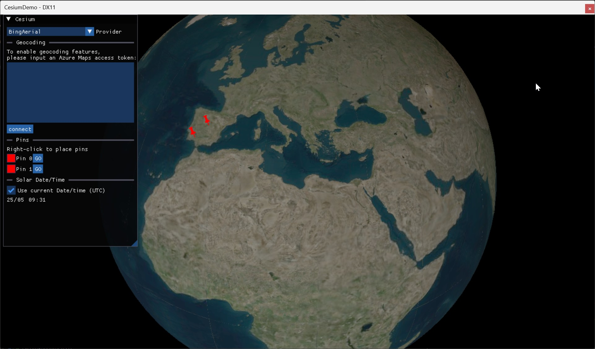
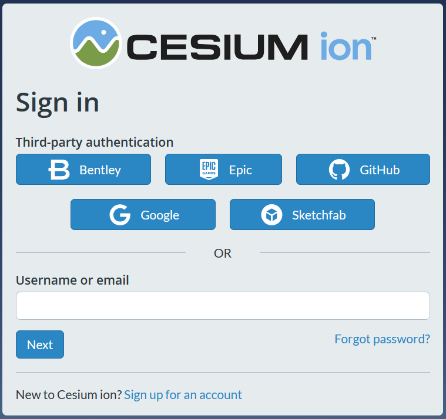
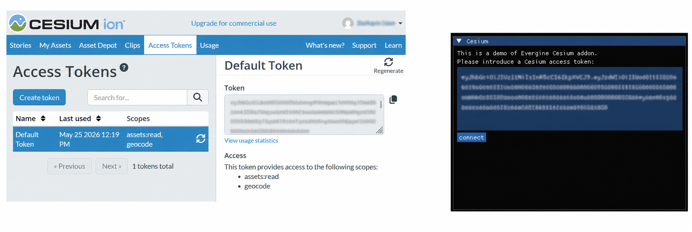
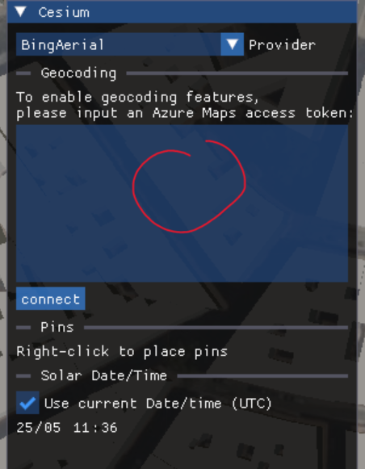

# CesiumDemo

Sample project that showcases the integration of **Cesium GIS technology** inside **Evergine**, including streamed 3D globe visualization, terrain overlays, geocoding, interactive pin placement, and solar lighting controls.

<p align="center">
  
</p>

## Overview

This repository demonstrates how to build a real-time geospatial experience in Evergine using the `Evergine.Cesium` addon. The sample connects to Cesium services at runtime, renders the globe with different imagery providers, and layers a small interaction workflow on top of the streamed terrain.

Beyond simply loading map data, the project also shows how to:

- Authenticate against Cesium services with a runtime token.
- Switch between different terrain imagery providers.
- Search locations through Azure Maps or Google Maps geocoding.
- Place 3D pins directly on the terrain using depth-based picking.
- Keep markers readable at any zoom level with constant screen-size billboarding.
- Adjust sun lighting based on UTC date and time.

## What This Sample Includes

- **Cesium streaming in Evergine** through `Evergine.Cesium`.
- **Multiple Windows render backends**:
  - DirectX 11
  - DirectX 12
  - Vulkan
- **ImGui-based runtime tooling** for tokens, provider selection, geocoding, pin management, and time controls.
- **Interactive terrain annotations** with editable names, color selection, and camera fly-to shortcuts.
- **Optional geocoding support** powered by Azure Maps or Google Maps.

## Solution Layout

- `CesiumDemo`: shared application logic and scene behavior.
- `CesiumDemo.Editor`: Evergine editor-side extensions.
- `CesiumDemo.Windows`: Windows launcher using DirectX 12.
- `CesiumDemo.Windows.DirectX11`: Windows launcher using DirectX 11.
- `CesiumDemo.Windows.Vulkan`: Windows launcher using Vulkan.
- `Content`: scene, mesh, font, and environment assets.

## Requirements

- Windows machine with GPU support for the selected backend.
- [.NET 10 SDK 10.0.201](https://dotnet.microsoft.com/).
- Visual Studio 2022 or later recommended.
- Internet access to reach Cesium services.
- A **Cesium ion access token**.
- An **Azure Maps** or **Google Maps** API key if you want geocoding/autocomplete features.

The project references **Evergine nightly packages** through [`nuget.config`](nuget.config), so package restore must be able to reach both NuGet.org and the Evergine nightly feed.

## Running the Demo

1. Open the solution that matches the rendering backend you want to test:
   - `CesiumDemo.Windows.sln`
   - `CesiumDemo.Windows.DirectX11.sln`
   - `CesiumDemo.Windows.Vulkan.sln`
2. Restore NuGet packages.
3. Set the startup project for the selected solution if needed.
4. Run the application from Visual Studio.
5. Paste a valid **Cesium ion** token into the startup window and press `connect`.
6. Optionally, pick a geocoding provider in the main panel, paste its **Azure Maps** or **Google Maps** key, and press `use this provider`.

## Cesium ion Token

You can create a free evaluation account at [ion.cesium.com](https://ion.cesium.com/).

<p align="center">
  
</p>

After signing in, copy your access token and paste it into the demo startup panel:

<p align="center">
  
</p>

## Geocoding Keys

Geocoding is optional, but if you want to search for cities or addresses from inside the demo, create an **Azure Maps** key and/or a **Google Maps** key and paste it into the geocoding section of the UI.

The section has a **Provider** combo (Azure Maps / Google Maps) and one key box per provider, so you can store both keys and switch between them at any time. Only one provider is active at a time; press `use this provider` (or `update key` if it is already active) to apply the key shown.

<p align="center">
  
</p>

For Google Maps, enable the **Geocoding API v4** and the **Places API (New)** in your Google Cloud project. Google's provider has no true type-ahead: its autocomplete suggestions are built from geocoding results.

> A key embedded in a desktop application can be extracted. Restrict the key, and route requests through a protected backend if it must stay secret.

## Using Evergine.Cesium in Your Own Project

The demo builds a `CesiumCoordinator` at runtime ([`MyScene.cs`](CesiumDemo/MyScene.cs)). The minimal setup looks like this:

```csharp
using Evergine.Cesium;
using Evergine.Cesium.Utils;

CesiumCoordinator cesium = new CesiumCoordinator()
{
    AccessToken = "<CESIUM_ION_TOKEN>",
    EntityManager = this.Managers.EntityManager,
    OverlayProvider = RasterOverlayProvider.BingAerial,
};

// The coordinator starts with no tilesets: add the ones you want to render.
cesium.AddOverlayedTileset(1, RasterOverlayProvider.BingAerial, "Terrain"); // Cesium World Terrain + imagery overlay
cesium.AddGeometryTileset(96188, "Buildings");                              // Cesium OSM Buildings

// Optional: enable geocoding (Azure Maps or Google Maps).
cesium.GeocodingService = new AzureMapsGeocodingService("<AZURE_MAPS_KEY>");
// cesium.GeocodingService = new GoogleMapsGeocodingService("<GOOGLE_MAPS_API_KEY>");

this.Managers.AddManager(cesium);
```

Notes on the API (Evergine.Cesium 2026.9 and later):

- The overlay enum is `RasterOverlayProvider` (formerly `TerrainOverlayProvider`).
- Tilesets are no longer created implicitly. Without `AddOverlayedTileset` / `AddGeometryTileset` the globe renders **nothing**. Use `RemoveTileset(name)` to remove one.
- Geocoding is configured by assigning an `IGeocodingService` to `GeocodingService` (formerly `AzureMapsKey`). `IsGeocodingConfigured` tells whether one is set.
- Suggestion coordinates (`Latitude` / `Longitude`) are nullable, so check `HasValue` before calling `FlyTo`.
- Your scene needs an entity tagged `MainCamera` with a `Camera3D` component.

## Runtime Features

Once connected, the sample lets you explore several integration points:

- **Overlay provider selection** to compare different imagery styles.
- **Geocoding and autocomplete** for quick camera navigation to places.
- **Right-click pin placement** on streamed terrain.
- **Pin editing**:
  - rename pins
  - recolor markers
  - delete annotations
  - jump the camera back to a saved pin
- **Solar date/time controls** to preview how lighting changes over the globe.

## Controls

| Action | Result |
| --- | --- |
| `Right click` | Place a pin on the terrain |
| `GO` button | Fly the camera to a saved pin |
| Provider combo | Change terrain imagery overlay |
| Geocoding input | Search and navigate to a place |
| Solar Date/Time panel | Update sun direction using UTC time |

## Implementation Notes

- The sample uses a custom **depth-picking** helper to recover terrain positions from the depth buffer.
- Pins are attached to the globe through `CesiumPlacerComponent`, so they remain georeferenced.
- Marker readability is preserved with a custom **constant-size billboard** behavior.
- Entered tokens are persisted locally in:
  - `cesium_access_token.txt`
  - `azure_access_token.txt`
  - `google_access_token.txt`

## Why This Repository Is Useful

If you are evaluating Cesium support in Evergine, this sample is a practical reference for:

- bootstrapping Cesium services inside an Evergine application,
- connecting GIS data with a real-time 3D scene,
- adding runtime tools for map exploration,
- implementing terrain-aware interactions and annotations,
- validating the integration across different graphics backends.

## Powered By

- [Evergine](https://evergine.com/)
- [Cesium](https://cesium.com/platform/cesium-ion/)
- [Azure Maps](https://azure.microsoft.com/products/azure-maps/)
- [Google Maps Platform](https://developers.google.com/maps)
